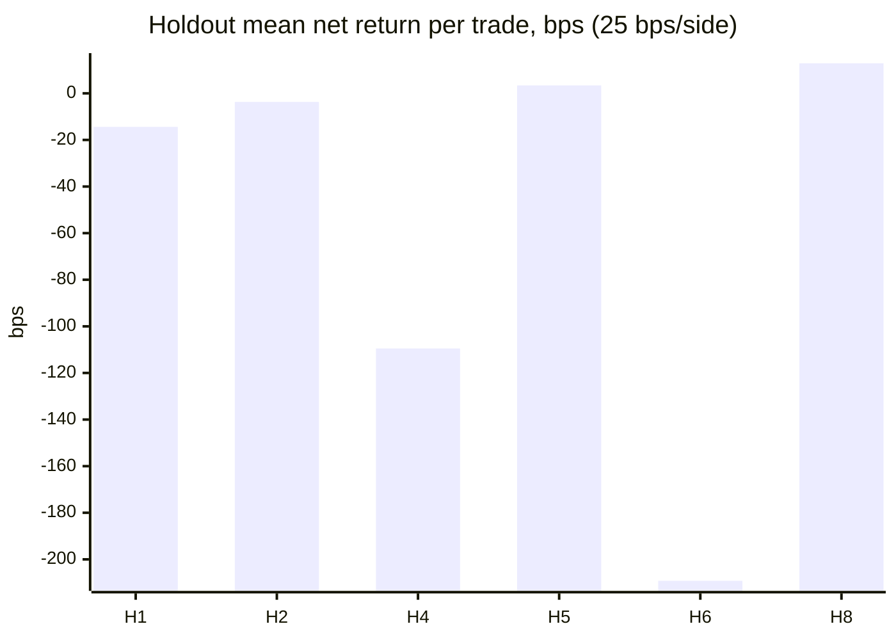

# Real-equity strategy evaluation — `2026-10-21-fixed78-sip-8y-r2`

* Run status: **COMPLETED**
* Aggregate conclusion: **NO_TRADE** — DISABLED (research only; no promotion, no group signals, no orders)
* Protocol `realeq-protocol-1` (sha256 `721d3e3e3b82a602…`), code `2acad29f75a81dbde0a469d1634d8b273de5c9ea`
* Data: Alpaca `sip` daily bars, split-adjusted, price-only; universe fixed78 (66 traded stocks); dataset hash `f428e39edbc92f56…`
* Development 2019-10-23 → 2025-05-01; embargo/purge before 2025-04-25; **untouched holdout 2025-05-02 → 2026-09-21** (348 sessions)

## Summary (primary configuration: H=20 sessions, 25 bps per side, holdout, rule = qualified + regime-allowed + de-duplicated signals)

| Hypothesis | Disposition | Holdout trades | Mean net | Bootstrap p10 | Win rate | Mean R | Profit factor | Matched-random median | Pctl vs random | Forecast |
|---|---|---|---|---|---|---|---|---|---|---|
| h1_vcp_breakout | **INSUFFICIENT_HISTORY** | 16 | -0.144% | -2.103% | 43.8% | 0.018 | — | 0.406% | 0.34 | UNVALIDATED |
| h2_rs_pullback | **INSUFFICIENT_HISTORY** | 39 | -0.037% | -1.491% | 38.5% | 0.022 | 0.99 | -0.258% | 0.62 | UNVALIDATED |
| h3_post_event_drift | **NOT_EVALUABLE_MISSING_INPUT** | 0 | — | — | — | — | — | — | — | — |
| h4_oversold_recovery | **INSUFFICIENT_HISTORY** | 7 | -1.095% | -3.590% | 42.9% | -0.172 | — | -0.603% | 0.40 | UNVALIDATED |
| h5_sector_rotation | **UNVALIDATED** | 225 | 0.034% | -0.555% | 39.6% | -0.078 | 1.01 | 0.020% | 0.52 | UNVALIDATED |
| h6_gap_and_hold | **INSUFFICIENT_HISTORY** | 11 | -2.092% | -4.139% | 27.3% | -0.407 | — | -0.166% | 0.14 | UNVALIDATED |
| h7_catalyst_compression | **NOT_EVALUABLE_MISSING_INPUT** | 0 | — | — | — | — | — | — | — | — |
| h8_turn_of_month | **FAILED_REAL_OOS** | 140 | 0.129% | -0.650% | 37.1% | -0.036 | 1.06 | 0.648% | 0.16 | UNVALIDATED |

A high win rate is not an edge: compare mean net, the bootstrap p10 and mean R (average losses vs gains).

## Baselines (same levels-from-ATR, execution and costs; holdout)

| Baseline | Holdout trades | Mean net | Bootstrap p10 | Win rate | Mean R |
|---|---|---|---|---|---|
| momentum_20 | 30 | 1.189% | -0.549% | 43.3% | 0.209 |
| breakout_basic | 478 | -0.021% | -0.376% | 40.2% | -0.051 |

SPY buy-and-hold over the holdout: total 36.41%, CAGR 23.55%, max drawdown -9.13% — 100% exposure, not a fair comparator for a swing book.

## Cost sensitivity (holdout mean net per trade)

| Hypothesis | 0 bps/side | 10 bps/side | 25 bps/side | 50 bps/side |
|---|---|---|---|---|
| h1_vcp_breakout | 0.356% | 0.156% | -0.144% | -0.642% |
| h2_rs_pullback | 0.464% | 0.263% | -0.037% | -0.536% |
| h3_post_event_drift | — | — | — | — |
| h4_oversold_recovery | -0.599% | -0.798% | -1.095% | -1.588% |
| h5_sector_rotation | 0.536% | 0.335% | 0.034% | -0.465% |
| h6_gap_and_hold | -1.601% | -1.798% | -2.092% | -2.580% |
| h7_catalyst_compression | — | — | — | — |
| h8_turn_of_month | 0.631% | 0.429% | 0.129% | -0.371% |

## Horizon sensitivity (holdout mean net at 25 bps; time exit at H sessions)

| Hypothesis | H=5 | H=10 | H=15 | H=20 |
|---|---|---|---|---|
| h1_vcp_breakout | 0.026% (n=16) | -0.685% (n=16) | -0.073% (n=16) | -0.144% (n=16) |
| h2_rs_pullback | 0.314% (n=40) | 0.142% (n=39) | 0.289% (n=39) | -0.037% (n=39) |
| h3_post_event_drift | — (n=0) | — (n=0) | — (n=0) | — (n=0) |
| h4_oversold_recovery | -2.008% (n=7) | -2.974% (n=7) | -1.227% (n=7) | -1.095% (n=7) |
| h5_sector_rotation | -0.227% (n=251) | -0.135% (n=231) | -0.164% (n=226) | 0.034% (n=225) |
| h6_gap_and_hold | -1.187% (n=11) | -0.919% (n=11) | -1.243% (n=11) | -2.092% (n=11) |
| h7_catalyst_compression | — (n=0) | — (n=0) | — (n=0) | — (n=0) |
| h8_turn_of_month | 0.095% (n=142) | -0.090% (n=142) | 0.282% (n=142) | 0.129% (n=140) |

## Capital-constrained book (10 equal slots, holdout, 25 bps/side)

| Book | Taken | Skipped (capacity) | Total | CAGR | Max DD | Avg exposure | SPY same period | SPY × exposure |
|---|---|---|---|---|---|---|---|---|
| h1_vcp_breakout | 16 | 0 | -0.25% | -0.21% | -1.85% | 4.6% | 26.78% | 1.22% |
| h2_rs_pullback | 39 | 0 | -0.24% | -0.17% | -3.50% | 9.8% | 29.16% | 2.86% |
| h4_oversold_recovery | 7 | 0 | -0.77% | -0.72% | -2.16% | 2.7% | 21.53% | 0.57% |
| h5_sector_rotation | 213 | 12 | 1.94% | 1.38% | -12.29% | 52.5% | 35.34% | 18.56% |
| h6_gap_and_hold | 11 | 0 | -2.30% | -2.14% | -2.51% | 3.9% | 21.31% | 0.82% |
| h8_turn_of_month | 124 | 16 | 1.07% | 0.80% | -6.95% | 32.2% | 29.39% | 9.47% |
| momentum_20 | 30 | 0 | 3.56% | 2.72% | -2.90% | 7.1% | 27.04% | 1.91% |
| breakout_basic | 305 | 173 | 0.72% | 0.50% | -11.66% | 70.8% | 36.96% | 26.16% |

## Does Quality rank realized net R? (Spearman, weekly-block bootstrap 90% interval)

| Hypothesis | Holdout n | Spearman | 90% CI | Development Spearman |
|---|---|---|---|---|
| h1_vcp_breakout | 16 | -0.341 | [-0.7835, 0.3037] | 0.052 |
| h2_rs_pullback | 39 | 0.009 | [-0.2297, 0.253] | 0.186 |
| h4_oversold_recovery | 7 | — | — | -0.136 |
| h5_sector_rotation | 225 | 0.002 | [-0.1528, 0.1544] | 0.021 |
| h6_gap_and_hold | 11 | 0.718 | [0.2711, 0.9634] | 0.085 |
| h8_turn_of_month | 140 | 0.246 | [0.0645, 0.3882] | -0.075 |

## Robustness: held-out sector groups (rule, holdout) and cross-sector model

Group A = technology, energy, industrials, consumer_staples, materials, communication_services; group B = financials, health_care, consumer_discretionary, utilities, real_estate.

| Hypothesis | Group A mean net | Group B mean net | Model A→B Brier skill | Model B→A Brier skill |
|---|---|---|---|---|
| h1_vcp_breakout | 0.120% (n=10) | -0.585% (n=6) | — | — |
| h2_rs_pullback | -0.485% (n=28) | 1.104% (n=11) | — | — |
| h4_oversold_recovery | -1.372% (n=5) | -0.401% (n=2) | — | — |
| h5_sector_rotation | 0.819% (n=139) | -1.234% (n=86) | -0.0369 | -0.0505 |
| h6_gap_and_hold | -1.454% (n=7) | -3.209% (n=4) | — | — |
| h8_turn_of_month | 0.016% (n=84) | 0.297% (n=56) | -0.1209 | -0.1914 |

## Forecast model (existing pipeline, promotion-policy-2 gates on the same frozen holdout)

| Hypothesis | Status | Holdout n | Brier skill | ECE | Permutation p | Threshold | Selected n | Selected mean net |
|---|---|---|---|---|---|---|---|---|
| h1_vcp_breakout | UNVALIDATED | — | — | — | — | — | 0 | — |
| h2_rs_pullback | UNVALIDATED | — | — | — | — | — | 0 | — |
| h4_oversold_recovery | UNVALIDATED | — | — | — | — | — | 0 | — |
| h5_sector_rotation | UNVALIDATED | 566 | -0.0126 | 0.0480 | 0.524 | 0.28 | 423 | -0.416% |
| h6_gap_and_hold | UNVALIDATED | — | — | — | — | — | 0 | — |
| h8_turn_of_month | UNVALIDATED | 142 | -0.1183 | 0.1362 | 0.952 | 0.26 | 55 | 0.121% |

## Execution mechanics (holdout, rule)

| Hypothesis | Signals | Fill rate | No fill | Target/Stop/Time | Same-bar ambiguous | Gap through stop | Mean net excl. ambiguous | Avg hold | MFE / MAE |
|---|---|---|---|---|---|---|---|---|---|
| h1_vcp_breakout | 16 | 100.0% | 0 | 6/8/2 | 0 (0.0%) | 0 | -0.144% | 8.8 | 4.38% / -3.27% |
| h2_rs_pullback | 41 | 95.1% | 2 | 11/19/9 | 0 (0.0%) | 2 | -0.037% | 8.6 | 5.03% / -3.57% |
| h4_oversold_recovery | 7 | 100.0% | 0 | 1/4/2 | 0 (0.0%) | 3 | -1.095% | 10.1 | 4.40% / -5.23% |
| h5_sector_rotation | 238 | 94.5% | 13 | 67/130/28 | 0 (0.0%) | 17 | 0.034% | 8.6 | 4.53% / -3.43% |
| h6_gap_and_hold | 11 | 100.0% | 0 | 2/7/2 | 0 (0.0%) | 0 | -2.092% | 9.4 | 3.68% / -4.44% |
| h8_turn_of_month | 155 | 90.3% | 15 | 41/78/21 | 0 (0.0%) | 5 | 0.129% | 8.9 | 4.40% / -3.06% |

## Funnel (all sessions in the decision window, H=20)

| Hypothesis | Triggered | Gate eligible | Quality scored | Levels valid | Regime allowed | After de-dup | Filled | Completed |
|---|---|---|---|---|---|---|---|---|
| h1_vcp_breakout | 126 | 107 | 107 | 78 | 77 | 76 | 70 | 70 |
| h2_rs_pullback | 944 | 739 | 739 | 218 | 205 | 148 | 137 | 137 |
| h3_post_event_drift | 0 | 0 | 0 | 0 | 0 | 0 | 0 | 0 |
| h4_oversold_recovery | 69 | 55 | 55 | 55 | 50 | 43 | 41 | 41 |
| h5_sector_rotation | 4704 | 4334 | 4334 | 2342 | 2265 | 958 | 908 | 908 |
| h6_gap_and_hold | 129 | 68 | 68 | 54 | 53 | 52 | 48 | 48 |
| h7_catalyst_compression | 0 | 0 | 0 | 0 | 0 | 0 | 0 | 0 |
| h8_turn_of_month | 1904 | 1639 | 1639 | 725 | 678 | 660 | 621 | 621 |

## Ablations and other attempted variants (holdout)

| Hypothesis | Rule mean net | All regimes | Quality top half | Model skill (full) | Model skill (no Quality) |
|---|---|---|---|---|---|
| h1_vcp_breakout | -0.144% | -0.144% | -0.513% | — | — |
| h2_rs_pullback | -0.037% | -0.096% | 1.778% | — | — |
| h4_oversold_recovery | -1.095% | 0.589% | -5.956% | — | — |

Configurations evaluated in total: **229** (all listed in strategy_metrics.json; dispositions use only the pre-registered primary configuration, Holm-adjusted).

## Data and limitations

* SURVIVORSHIP: fixed universe of currently listed large caps; historical results are optimistic
* SECTOR LABELS: current classification applied to all history (mild look-ahead in sector-relative features)
* EARNINGS UNKNOWN: no point-in-time earnings calendar in CI; earnings vetoes not modelled
* NO CATALYSTS: catalyst-dependent strategies produce no events in CI training
* PRICE-ONLY RETURNS: split-adjusted bars, dividends not modelled
* REFERENCE ASSETS: SPY and the 11 sector SPDRs feed relative-strength/sector features and are never traded
* UNIVERSE SIZE: 66 large caps in 11 sectors; results describe this sample, not U.S. equities in general
* DAILY BARS: intraday order of high/low is unknown; same-bar target+stop is resolved stop-first
* SPIN-OFFS: split-only adjustment leaves spin-off / special distributions as price drops (e.g. T 2022, GE 2023-2024); a trade held across such an ex-date can book a false loss (large moves are flagged)
* Daily OHLC cannot reveal the intraday order of the high and low; same-bar target+stop is booked as a loss.
* The universe is 66 surviving large caps: results describe this sample, not a generalizable population.

